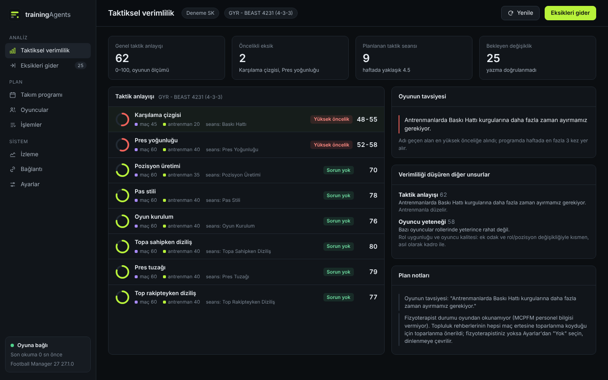
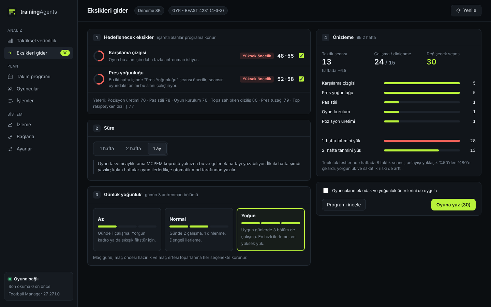
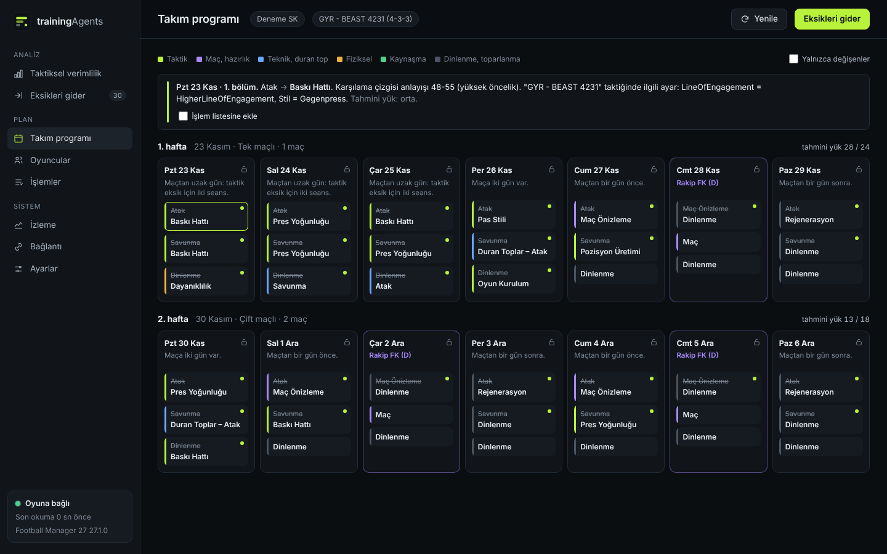
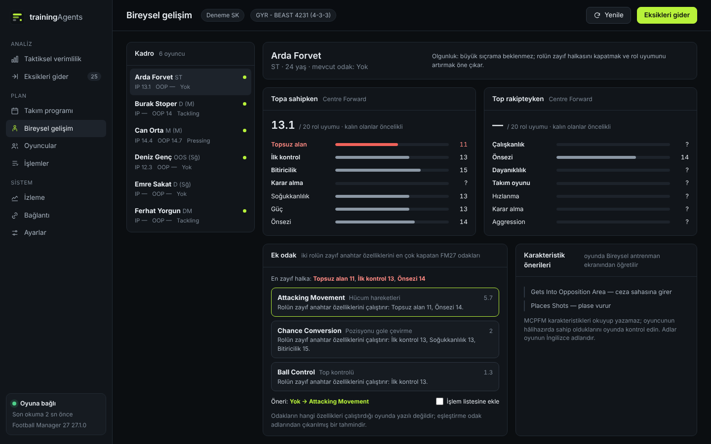

<p align="center"></p>

# TrainingAgents

Football Manager 27 için antrenman planlayıcısı. Oyuna canlı bağlanır, taktiğinizin **Taktiksel Verimlilik** ekranını
okur ve eksik alanları kapatan takım programını, seçtiğiniz süre (1 hafta / 2 hafta / 1 ay) ve yoğunlukla
(Az / Normal / Yoğun) kurup oyuna yazar. Her değişikliği oyundan geri okuyarak doğrular.

İki biçimde gelir:

- **TrainingAgents.exe** — kendi penceresinde çalışan masaüstü uygulaması. Kurulum gerektirmez, tek dosyadır. Oyunu
  birkaç saniyede bir yoklar; taktik ya da taktik anlayışı oyunda değişince ekran kendiliğinden güncellenir.
- **Oyun içi eklenti** (BepInEx) — FM27'nin içinde F8 ile açılan panel.

İkisi de oyuna [MCPFM](https://github.com/FootballManagerMCP/FootballManagerMCP) üzerinden bağlanır.

## TrainingAgents.exe

1. MCPFM'i kurun (BepInEx köprüsü ve API, MCPFM README'sindeki 1–5. adımlar) ve API'yi başlatın.
2. `TrainingAgents.exe`'yi çalıştırın, sonra FM27'yi açıp kariyerinizi yükleyin. Sol alttaki gösterge
   "Oyuna bağlı" olunca her şey canlıdır.
3. **Eksikleri gider** → eksik alanları işaretleyin, süreyi ve yoğunluğu seçin, önizlemeye bakın → **Oyuna yaz**.

`TrainingAgents.exe --demo` oyun açmadan sahte bir kariyerle çalışır. Ayarlar ve kayıtlar `%APPDATA%\TrainingAgents`
altındadır; MCPFM adresleri `baglanti.json` dosyasından değiştirilebilir. Pencere Windows 10/11'de yerleşik gelen
Microsoft Edge WebView2'yi kullanır; yoksa panel varsayılan tarayıcıda açılır.

**Derleme:** Depoya her gönderimde GitHub Actions `.exe`'yi Windows'ta yeniden üretir (Actions → "TrainingAgents exe"
→ Artifacts). Elle derlemek için:
```powershell
dotnet publish src\TrainingAgents -c Release -r win-x64 -o cikti
```






## Bireysel gelişim

Her oyuncu için oynanan taktikteki iki rolü birlikte ele alır:
- **Topa sahipken** ve **top rakipteyken** rolünün öncelikli ve destekleyici özellikleri, oyuncunun bu özelliklerdeki
  değerleri ve 20 üzerinden rol uyumu
- En zayıf halka ve onu en çok kapatan **FM27 ek odağı** (oyundaki 28 odak: Chance Conversion, Ball Retention,
  Pressing, Containment, Quickness…)
- Aynı mevkide daha uygun rol alternatifi
- Yaşa göre gelişim penceresi
- Role uygun **karakteristik** önerileri

Rol–özellik tablosu [Touchline FM27 rol rehberinden](https://touchlinefm.com/tactics) alındı (rehberin kendi notuyla
resmi eşik değil, koçluk yorumu). Odak listesi FM27'nin bireysel antrenman ekranındaki listedir. Odakların hangi
özellikleri çalıştırdığı oyunda yazılı değildir, eşleştirme tahmindir. Ek odak oyuna yazılabilir; rol değişikliği ve
karakteristikler MCPFM ile yazılamadığı için yalnızca önerilir.

## Nasıl çalışır?

```
FM27 ──► MCPFM köprüsü (oyun içi, :5121) ──► MCPFM API (:5120) ◄── Antrenman Asistanı (oyun içi eklenti)
                                                                     ├─ F8: oyun içi panel
                                                                     └─ http://localhost:5130 : ayrıntılı panel
```

Oyun verisini [MCPFM](https://github.com/FootballManagerMCP/FootballManagerMCP) ile okur ve yazar. MCPFM'in kendi
güvenlikleri de geçerlidir: her yazmadan önce oyunun izin verdiği seçenekler kontrol edilir, maç sırasında yazma
reddedilir ve hiçbir araç oyunu kaydetmez ya da günü ilerletmez.

## Kurulum (Windows)

1. **MCPFM'i kurun:** BepInEx, MCPFM köprüsü ve MCPFM API'si için MCPFM README'sindeki 1-5. adımları izleyin.
   Bunun için .NET 10 SDK gerekir; aynı SDK bu eklentiyi de derler.
2. **Football Manager kapalıyken** bu klasörde PowerShell açıp şunu çalıştırın:
   ```powershell
   .\kur.ps1
   ```
   Oyun başka bir klasördeyse: `.\kur.ps1 -OyunKlasoru "D:\...\Football Manager 27"`
3. MCPFM API'sini başlatın (`dotnet run --project src\FootballManager\FootballManager.Api`, MCPFM klasöründe) ve oyunu açın.
4. Oyunda **F8** paneli açar. Sağ alttaki "Antrenman (F8)" düğmesi de aynı işi görür.

**Oyun içi panel derlenmezse:** Bazı Unity derlemelerinde IMGUI metotları ayıklanmış olabilir. Bu durumda derleme
`GUI`/`GUIStyle` hatası verir. Paneli tarayıcı üzerinden kullanmak için şöyle derleyin:
```powershell
.\kur.ps1 -YalnizcaTarayiciPaneli
```
Panel oyun açıkken http://localhost:5130 adresinde çalışır.

**Oyunsuz deneme:** `.\demo.ps1`, sahte bir kariyerle paneli http://localhost:5130 adresinde açar.

## Kullanım

**En kısa yol: "⚡ Eksikleri gider" (oyun içinde F8 panelindeki büyük düğme).** Tek tıkla:
1. Oyun okunur.
2. Taktik ekranındaki 8 alan ve oyunun kendi tavsiyesine göre iki haftalık program kurulur. Örneğin oyun
   "Antrenmanlarda Baskı Hattı kurgularına daha fazla zaman ayırmamız gerekiyor." diyorsa o alan yüksek önceliğe alınır.
3. Bu sürümde yazma henüz doğrulanmadıysa önce yazma testi yapılır.
4. Seanslar oyuna yazılır ve geri okunarak doğrulanır.

Ayarlar'daki **Otomatik mod** açılırsa, oyun yeni haftaya geçtiğinde ya da taktiği değiştirdiğinizde bu kendiliğinden
tekrarlanır.

Adım adım kullanım:

1. **Bağlantı → Yetenek matrisini çıkar.** Hangi verinin okunabildiğini, hangi yazmanın oyunun ön kontrolünden
   geçtiğini gösterir. Oyunda hiçbir şey değişmez.
2. **Bağlantı → Yazma testini çalıştır** (bir kez, kayıt yedeğiniz varken). Bir yoğunluk, bir ek odak ve bir seansı
   değiştirip geri okur, sonra eski haline getirip yine geri okur. Hepsi doğrulanırsa bu oyun/köprü sürümünde yazma
   açılır. Doğrulanmamış bir sürümde uygulama yalnızca okur ve öneri yapar.
3. **Oyundan oku ve analiz et.** Taktik eksik kartları, iki haftalık program ve oyuncu önerileri gelir.
4. **Takım programı / Oyuncular:** önerileri inceleyin. Bir güne 🔒 koyarak kilitleyebilir, oyuncuyu **Koru** ya da
   **Hariç tut** ile dışarıda bırakabilirsiniz.
5. **Önizle ve uygula:** istediğiniz değişiklikleri seçip uygulayın. Rapor her kalem için eski, hedef ve oyundan okunan
   değeri gösterir.
6. Gerekirse **İşlem günlüğü → Geri al**.

## Kurallar

**Analiz.** Öncelik = eksiklik × taktik açısından önem × veri güveni.
- **Eksiklik:** Hedef anlayışın (varsayılan 75) altında kalan fark. Diğer alanlardan belirgin düşük olan alan biraz
  daha öne alınır.
- **Önem:** Taktiğin talimatlarından çıkarılır. Örneğin `PressingIntensity = MuchMoreUrgent` ya da `Gegenpress` stili
  pres alanlarını öne çeker, `LessUrgent` geri iter.
- **Güven:** Oyun değeri aralık olarak verirse (`45-52`) düşer. Taktik okunamazsa da düşer.
- **Okunamayan alan:** "Veri yok" olarak gösterilir, düşük değer sayılmaz ve bu alan için seans önerilmez.

**Takım programı.** Planlama şu sırayla ilerler:
1. Maç, düzenlenemeyen seans ve kullanıcı kilidi sabitlenir.
2. Personel kısıtı uygulanır.
3. Maç çevresi yerleştirilir: maçtan bir gün önce hazırlık, bir gün sonra toparlanma.
4. Kalan kapasite öncelikli taktik eksiklere verilir.
5. Gelişim ve sosyal seanslar dengelenir.
6. Tekrar ve yük kontrol edilir.

Kurallar:
- **PLAN-01:** Maç seansına ve geçmiş ya da düzenlenemez güne yazılmaz.
- **PLAN-02:** Fikstür değişince yalnızca gelecekteki, kilitlenmemiş bölümler yeniden planlanır.
- **PLAN-03:** Maçsız, tek maçlı ve çift maçlı haftalar ayrı ele alınır. Örneğin çift maçlı haftada fiziksel seans
  konmaz ve günlük yük sınırı düşer.
- **PLAN-04:** MCPFM fizyoterapisti okuyamaz. Durumu **Ayarlar**'dan siz belirtirsiniz. "Yok" ya da "Bilmiyorum"
  seçiliyse toparlanma yerine dinlenme önerilir ve nedeni yazılır.
- **PLAN-05:** Aynı güne ikinci toparlanma seansı konmaz.
- **Yük:** Takım programı haftalık sınırın %85'ine kadar doldurulur; kalan pay bireysel yoğunluk artışı içindir.

**Bireysel.**
- **Yoğunluk:** Sağlık ekibinin kilidi ve sakatlık her zaman önce gelir, bu oyuncuların yoğunluğuna dokunulmaz.
  - Kondisyon kritik eşiğin altındaysa, ya da düşükken haftada iki maç veya ağır iş yükü varsa: düşük yoğunluk.
  - Kondisyonu çok iyi (≥%92), en fazla 23 yaşında ve haftada en fazla bir maçı olan oyuncu: yüksek yoğunluk.
  - Kondisyon okunamazsa yüksek yoğunluk asla önerilmez.
- **Ek odak:** Rolün anahtar özellikleri içinde en zayıf olanı çalıştıran odak önerilir.
  - İstikrar için odak 21 gün dolmadan yeniden değişmez.
  - Mevcut odak hâlâ anlamlıysa değiştirilmez.
  - Anahtar özellik ortalaması çok düşükse "rol uygun değil olabilir" uyarısı çıkar. Bu, ek odak önerisinden ayrı bir
    sonuçtur.
- **Pozisyon/rol değişikliği:** Yalnızca tavsiye edilir. MCPFM bunu yazmayı desteklemiyor.

**Uygulama.** Akış şöyledir:

Kimlik kontrolü → kalem kalem güncel değer kontrolü → oyunun ön kontrolü → tek tek gönderim → geri okuma → rapor.

Bu akışta:
- Plan yapıldıktan sonra kariyer, takım, takvim tarihi ya da aktif taktik değiştiyse **hiçbir şey gönderilmez**
  (K02, K10).
- Zaten hedefte olan kalem gönderilmez (K09).
- Plandan sonra oyunda elle değiştirdiğiniz bir kalemin üzerine yazılmaz.
- Zaman aşımında "başarılı" yazılmaz. Önce yeniden okunur; sonuç bilinmiyorsa kalem **belirsiz** kalır ve kalan
  kalemler gönderilmez (K08).
- "Doğrulandı" yalnızca seçilen her kalem oyundan geri okunup eşleştiyse gösterilir. Özet her zaman sayıyla yazılır
  ("Doğrulandı: 30/30"). "0 doğrulandı" hiçbir yerde "tamamlandı" diye görünmez.

## Kabul testleri

`dotnet test` komutu, oyunu taklit eden sahte bir bağlantıyla şartnamenin K01–K12 senaryolarını ve ek kuralları çalıştırır.

| No | Senaryo | Test |
|---|---|---|
| K01 | Düşük pres anlayışı; veri eksikliği ile gerçek düşük değer ayrımı | `K01_DusukPresAnlayisi_*`, `K01_VeriEksikligi_*` |
| K02 | Yeni taktik seçimi | `K02_YeniTaktik_*` |
| K03 | Çift maç haftası | `K03_CiftMacHaftasi_*` |
| K04 | Maç ertelenmesi, kilitli günler | `K04_MacErtelenmesi_*` |
| K05 | Eksik / bilinmeyen fizyoterapist | `K05_*` |
| K06 | Sakat ve kilitli oyuncu, kullanıcı kilidi | `K06_*` |
| K07 | Kısmi sonuç, takım bazında rapor | `K07_KismiSonuc_*` |
| K08 | Yazmada zaman aşımı (yazılmadı / yazıldı / okunamadı) | `K08_*` |
| K09 | Aynı planı yeniden gönderme | `K09_*` |
| K10 | Kariyer ve tarih değişimi | `K10_*` |
| K11 | Oyun sürümü değişimi, yazma testi | `K11_*` |
| K12 | Geri alma | `K12_*` |

Ek testler: PLAN-01, PLAN-05, determinizm (aynı girdi + aynı kural sürümü = aynı plan), maç sırasında durma, bireysel
kurallar, seans adı sınıflandırma (Türkçe/İngilizce/Fransızca).

## Henüz oyunda doğrulanmamış olanlar

Bu sürüm oyunsuz bir ortamda geliştirildi ve test edildi. Gerçek FM27'de ilk açılışta kontrol edilmesi gerekenler:

- **Oyun içi panel (IMGUI):** Eklenti, BepInEx'in IL2CPP arayüzüyle derlenir. Panelin FM27 arayüzünün üstünde görünüp
  görünmediği ve tıklamaların alttaki FM ekranına geçip geçmediği oyunda denenmeli. Sorun çıkarsa tarayıcı paneli
  aynı işlevleri sunar.
- **Seans adları:** Seanslar oyunun dilindeki adlarına göre sınıflandırılır. Türkçe FM27'nin tam seans adları bilinmediği
  için eşleşmeyen seanslar **Ayarlar → Seans eşleştirme** bölümünden bir kez düzeltilmeli. Yetenek matrisi kaç seansın
  sınıflandırılamadığını söyler.
- **Taktik talimat anahtarları:** Önem hesabı, talimat anahtarlarında kalıp arar. Eşleşme yoksa önem varsayılan kalır ve
  bu kartta açıkça yazar.
- **Ek odak adları:** Türkçe/İngilizce anahtar kelimelerle özelliğe bağlanır. Eşleşmeyen odak önerilmez.
- **MCPFM sürümü:** MCPFM 0.13.1 API'sine göre yazıldı (`/api/v1/training`, `/tactics`, `/squad`; köprüde `/status`).

## Klasör yapısı

```
fm27-antrenman-asistani/
├── kur.ps1, demo.ps1               Windows kurulum ve oyunsuz deneme
├── src/Asistan.Core/               Oyundan bağımsız motor (net6.0, dış paket yok)
│   ├── Veri/                       MCPFM DTO'ları, bağlantı, veri sözleşmesi (Okuma<T>), seans sınıflandırma, anlık görüntü
│   ├── Analiz/TaktikAnalizi.cs     Sorun kartları ve öncelik
│   ├── Planlama/                   Takım planlayıcı, bireysel planlayıcı, rol/odak eşleştirmeleri
│   ├── Uygulama/                   Fark, ön kontrol, sıralı uygulama, geri okuma, geri alma, yetenek testi
│   ├── Depo/YerelDepo.cs           Ayarlar, analiz geçmişi, işlem günlüğü (kariyer başına klasör)
│   ├── Arayuz/                     Yerel web paneli (index.html gömülü) ve görünüm modeli
│   └── Ayarlar.cs                  Kullanıcının değiştirebildiği eşikler ve kararlar
├── src/Asistan.Plugin/             BepInEx eklentisi: F8 paneli + web paneli başlatıcı
├── src/Asistan.Tests/              K01–K12 kabul testleri ve birim testleri
└── src/Asistan.Demo/               Sahte kariyerle web paneli
```

Kayıtlar `BepInEx\config\AntrenmanAsistani\` altında düz JSON dosyalarıdır: `ayarlar.json`, `yetenek-matrisi.json`,
`kariyerler\<anahtar>\islemler\*.json`, `analiz-gecmisi.jsonl`.

Eklentinin ayarları `BepInEx\config\fm27.antrenman.asistani.cfg` dosyasındadır: MCPFM adresleri, panel portu ve
kısayol tuşu.

## Sonraki sürümler (kapsam dışı)

U19/rezerv takımlar, sezon boyunca otomatik yeniden planlama, alternatif taktikler, koç atamaları, mentorluk.
Otomatik uygulama, ilk sürüm oyunda doğrulandıktan sonra açılacak; şu an her uygulama sizin onayınızla yapılır.
